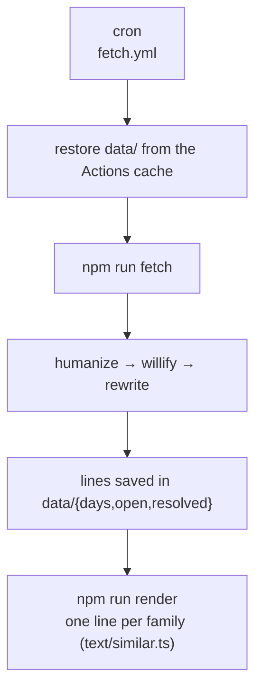
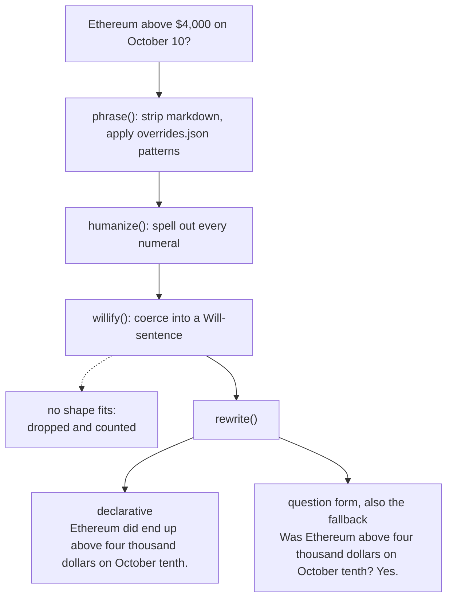

# Will / Did

_Questions about the future becoming statements for the past._

This is a project which generates a poem a day, selected from questions asked and answered on Polymarket. Prices, charts and trading buttons fall away, leaving behind sentences in the order that they were posed or resolved.

The homepage shows an evolving poem, as new questions are proposed and old ones are resolved. At midnight, the lines are sealed and archived as that day's page. For example:

```
Will Bitcoin reach $150,000 by December 31?      →  Bitcoin did reach one hundred fifty thousand dollars by December thirty-first.
Will there be a ceasefire by June thirtieth?     →  A ceasefire did not happen by June thirtieth.
```

## Run it

```sh
npm install
npm run build        # compiles src/ → dist/
npm test             # rewrite rules, merge and render tests
npm run fetch        # hits Polymarket, writes data/
npm run render       # data/ → public/: the site as plain HTML
npm run serve        # serves public/ at http://localhost:8000
```

## Structure

```
src/
  types.ts      shared types
  sources/      the market APIs (Polymarket, Kalshi) and the HTTP client
  text/         turning a market question into a line: numbers, grammar, overrides, grouping near-duplicates
  capture/      the hourly job and its working record in data/: fetch, run, store, backfill
  maintenance/  corrections and housekeeping: rerender, repair-archive, prune
  publish/      data/ + archive/ + site/ templates → public/: pages, feed, preview images
```

## How it works, end to end

Every hour, a GitHub Action fetches the markets, works out what changed, turns each market into a line of text, records it under the right day, renders the site, and deploys it. At midnight New York time a day seals, and its poem is committed to `archive/` for good.



- Fetch brings in its raw question (_Ethereum above $4,000 on October 10?_).
- `text/` turns that into a line (_Will Ethereum be above four thousand dollars on October tenth?_, and later _Ethereum did end up above…_)
- Render then chooses which saved lines go on the page, keeping one per family of near-duplicates, and fills them into the templates.

### 1. Fetch (`src/sources/`)

- Polymarket (`polymarket.ts`): the public Gamma API, no key. Each run reads:
  - every open market (about 250,000; `PM_MAX_PAGES` is a safety stop that fails the source rather than truncating it), and
  - every closed market whose scheduled end fell in the last `LOOKBACK_HOURS` (48).

  Tags come inline (`include_tag=true`), and anything tagged `Sports` is dropped.

- Kalshi (`kalshi.ts`): off by default (`SOURCES=polymarket`); same shape, with parlays excluded and sports matched by series.
- HTTP (`http.ts`): timeouts, and retries with backoff on 429s and 5xx (honoring `Retry-After`).

### 2. What changed (`src/capture/run.ts`)

`run()` is a short pipeline; only `pull` and `recheck` touch the network.

1. `pull`: fetch every source in parallel. Each market is judged: kept, excluded (sports, nobody traded, `MIN_VOLUME`, `EXCLUDE`), or dropped because it can't be phrased as a _Will…?_ sentence (still counted, just not kept).
2. `vanished`: markets open last run and missing now are resolved from the closed listing where possible, carried forward if their source failed, and otherwise set aside for a recheck.
3. `recheck` / `checked`: look those up one by one. A market the source no longer has is voided; a failed lookup keeps it open until next hour.
4. `seed`: settlements in the closed listing not yet recorded: anything a missed hour dropped, and on a first run the recent past. All are recorded; only those that settled on a day still open reach a page (see _The record_).
5. `askedOn`: open markets new this run whose creation falls on a day still open (today, or yesterday until it's sealed). Long-open markets seen for the first time, on a first fetch say, are tracked but don't flood today's page.

### 3. The text (`src/text/`)

Every market is turned into a line by rules:



- `prose.ts`, `numbers.ts`: `humanize()` applies ordered rule groups (labels, money and times, units, dates and ranges, then catch-alls) until no digit is left.
- `rewrite.ts`:
  - `willify()` tries each known question shape: already _Will…_, a wh-question with its answer, _Up or Down_, _above/below X_, _Is/Has X…_, _X hits Y_.
  - `rewrite()` turns a settled question into a _did_ / _did not_ sentence when it's safe to. Otherwise (negations like _no X_, unknown verbs, compound questions) it falls back to the question form: _Did no episode air? No._

### 4. The record (`src/capture/store.ts`, `data/`)

- `data/open/`: a snapshot of open markets, rewritten every run.
- `data/resolved/`: the final settlements.
- `data/days/YYYY-MM-DD.json`: each day's `asked`, `answered` and `voided` markets, plus its `runs` heartbeats.

Captures are filed under the day of their own timestamp (creation for asked, settlement for answered) while that day is still open. Only then are earlier days sealed. So the first run after midnight finishes yesterday at midnight exactly.

A settlement from a day already sealed goes on no page: that day's poem is final, and it didn't happen today. It stays in `data/resolved/`, so the next run knows it. This comes up whenever Polymarket closes a whole ladder the day its event happens (_Will X be released on October 14?_ is answered No the day X ships), weeks before the rungs' scheduled ends: a rung never tracked as open turns up in the closed listing only once its end date passes. `npm run repair-archive` drops such lines from poems sealed before this rule.

### 5. The site (`src/publish/`)

`render()`:

1. `gather`: reads every sealed poem from `archive/`. A day sealed since the last render is composed from `data/` and written to `archive/` now, once.
2. `compose` (`poem.ts`): chooses a day's lines. Near-duplicates are grouped into families (see _Handling duplicates_), and one member stands for each. Each line records its family's size and combined trading volume.
3. The now page keeps itself current. Once a minute it asks whether a newer copy has been published (a HEAD request, with a query string so Cloudflare's cached copy is skipped) and, when one has, fetches it and works the new lines into the page in place: new lines fade in, a line that has turned since strikes through, and at midnight the page becomes the new day. Sealed days don't poll. The interval is `EVERY` at the top of the script in `site/templates/day.hbs`.

### 6. Prune, commit, deploy

- `npm run prune` deletes the data that's now in `archive/`, and resolves shards older than three months.
- The only commit is new files in `archive/`, about 30 KB a day.
- `public/` is uploaded and deployed to GitHub Pages.

## Fixing the text, and regenerating what's already published

Every record keeps the market's raw `question` beside its rendered `line`, so wording can be fixed after the fact. Two decisions: where the fix goes, and what has to be regenerated.

### Where a fix goes

| Problem                                                          | Fix it in                                                                                                            | Example                                                                                                                                                                        |
| ---------------------------------------------------------------- | -------------------------------------------------------------------------------------------------------------------- | ------------------------------------------------------------------------------------------------------------------------------------------------------------------------------ |
| One market reads badly                                           | `overrides.json` → `lines`, keyed by market id                                                                       | `"pm:12345": "Did OpenAI IPO before 2027? No."`                                                                                                                                |
| A whole class of questions is phrased badly at the source        | `overrides.json` → `patterns`: a regex (case-insensitive) and replacement                                            | `{ "match": "^(.+?) # tweets (.+)$", "replace": "Will $1 post tweets $2?" }`                                                                                                   |
| A verb isn't recognised, so lines fall back to the question form | `overrides.json` → `verbs` for a quick fix; `REGULAR` in `src/text/rewrite.ts` to make it permanent                  | `"verbs": ["ipo", "headline", "dethrone"]`                                                                                                                                     |
| Numbers, money, dates or units are spelled wrong                 | a rule in `src/text/prose.ts` (in the right group: order matters), or `src/text/numbers.ts` for the words themselves | `"$3.0T"` read as _three dollars.zero T_                                                                                                                                       |
| A question shape isn't recognised at all                         | `SHAPES` in `src/text/rewrite.ts` (`willify`)                                                                        | _What will X say…: Word_                                                                                                                                                       |
| A settled sentence is built wrong                                | `parseClause` / `conjugate` in `src/text/rewrite.ts`                                                                 | _it rain_ → _It did rain_                                                                                                                                                      |
| Lines are grouped too much or too little                         | `src/text/similar.ts`, then `npm run repair-archive` to thin sealed days under the new rules                         | _Will "Whalefall" Opening Weekend Box Office be between $8m and $10m?_ was grouped with the unrelated _Will Avengers: Secret Wars be delayed?_, so no box-office line appeared |

## Handling duplicates

Much of the corpus is one sentence stated many times with a slot changed: a ladder of gold prices, the same temperature question for forty cities.

`src/text/similar.ts` groups these at render time: it masks numbers, names and dates (a week that crosses a month, _September 28-October 4_, is one date), drops comparisons (_above_, _or higher_) and the outcome (_did_ / _did not_), reads a ladder's verbs (_reach_, _dip to_, _hit_) as one, then joins templates within a few words of each other.

Rows are compared by their original question, so a Will line and a Did line from the same family group together, and a ladder that settled both ways is one family. Which member stands for its family is random but stable, so a sealed day reads the same on every visit.

The colophon at the end of the poem reports the selected and underlying counts.
